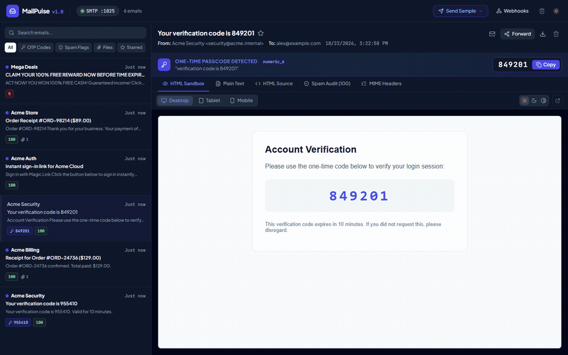
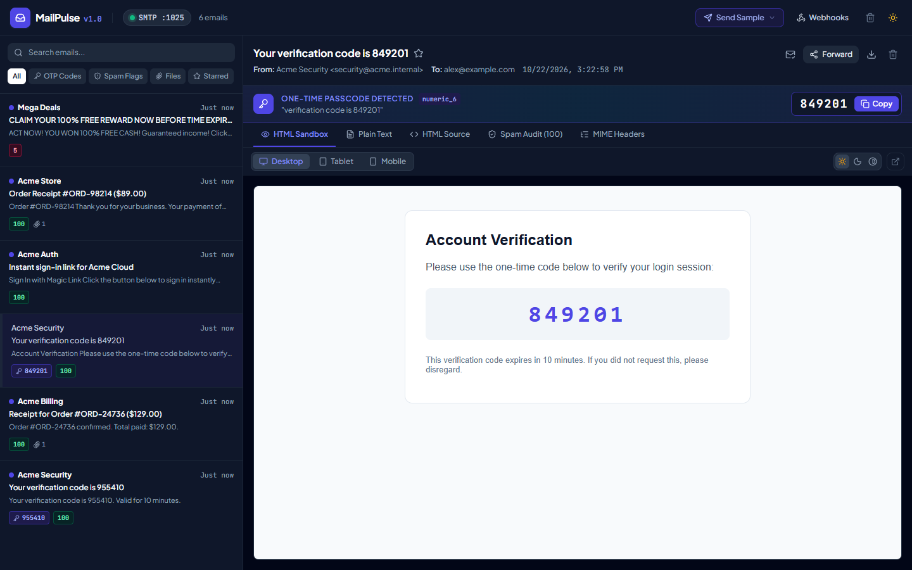
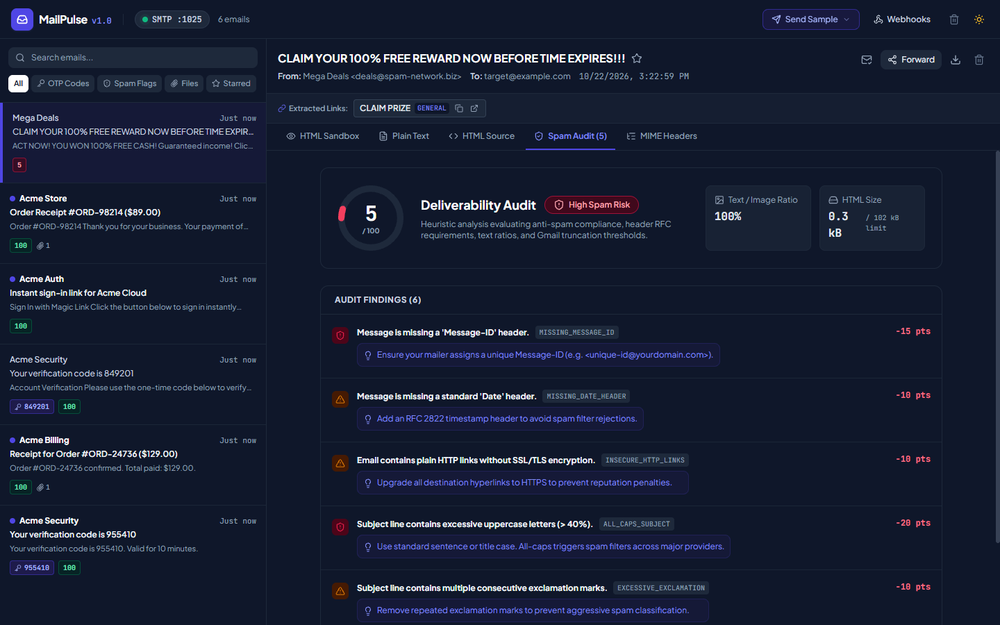
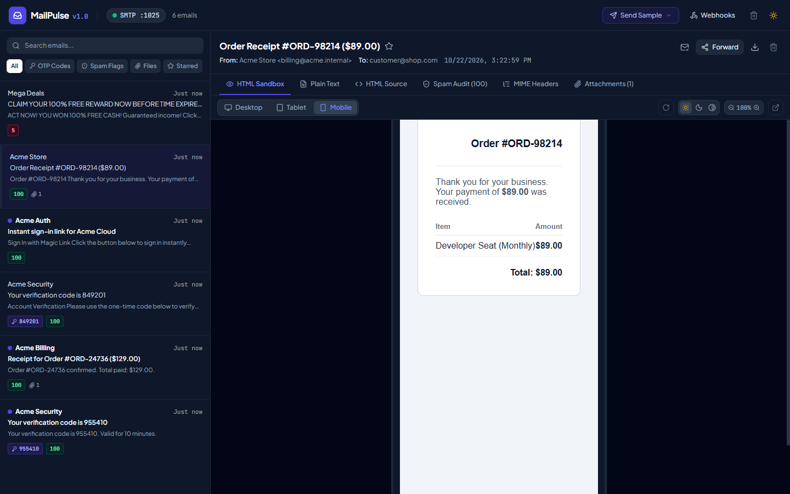
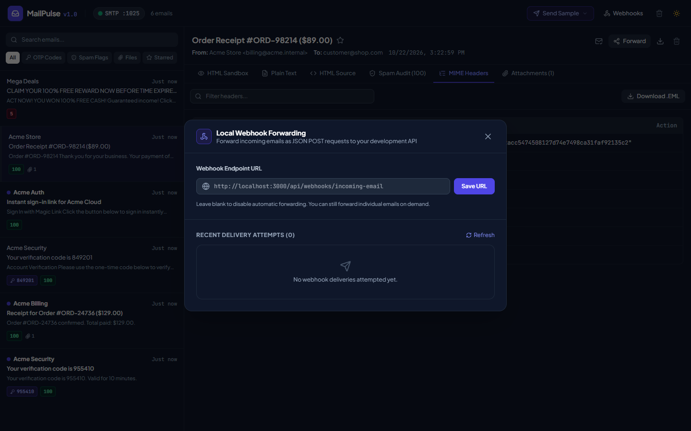

# MailPulse

Local SMTP capture server, responsive HTML email sandbox, and deliverability linter written in Go and React 19.

MailPulse intercepts outgoing email traffic on port 1025 during local application development. It provides an interactive web workspace on port 8025 to test HTML rendering across mobile and desktop viewports, audit spam scores, extract verification codes, and route received payloads to local webhooks.



## Studio Interface

| Desktop HTML Preview & OTP Extractor | Deliverability & Spam Score Linter |
| :---: | :---: |
|  |  |
| **Mobile Responsive Sandbox (iPhone 15)** | **MIME Headers & Webhook Forwarder** |
|  |  |

## Capabilities

- **Zero configuration SMTP capture**: Listens on `127.0.0.1:1025` and accepts plain or authenticated SMTP traffic from any framework without setup.
- **Responsive email sandbox**: Renders HTML emails in sandboxed iframes with viewport presets for Desktop, iPad, iPhone 15, and Android devices.
- **Dark mode simulation**: Emulates both standard `prefers-color-scheme: dark` CSS rules and email client background color inversions.
- **1-click OTP extraction**: Automatically identifies 4 to 8 digit verification PINs and authentication magic links with instant clipboard copy buttons.
- **Deliverability and spam audit**: Calculates a score from 0 to 100 based on text-to-image ratio, subject line capitalization, missing RFC 5322 headers, and Gmail 102 kB clipping limits.
- **CID image resolution**: Automatically converts inline `cid:<id>` multipart image references into viewable data URIs.
- **Local webhook forwarding**: Dispatches captured messages as JSON payloads to local HTTP endpoints in real time.
- **Single binary distribution**: Packages the React 19 web frontend directly into the Go executable via `go:embed`.

## Quick Start

### Installation

Clone the repository and build the binary:

```bash
git clone https://github.com/alexandrmotologa/mailpulse.git
cd mailpulse
go build -o mailpulse cmd/mailpulse/main.go
./mailpulse
```

Or run directly with Go:

```bash
go run cmd/mailpulse/main.go
```

By default:
- The SMTP server listens on `127.0.0.1:1025`
- The web studio interface opens at `http://127.0.0.1:8025`

### Command Line Options

```text
Usage of mailpulse:
  --smtp-port int      Port for incoming SMTP connections (default 1025)
  --web-port int       Port for the web studio interface and API (default 8025)
  --host string        Host interface to bind to (default "127.0.0.1")
  --persist            Persist messages to a local SQLite database (default false)
  --db-path string     File path for the SQLite database (default "mailpulse.db")
  --max-messages int   Maximum messages to retain in memory (default 500)
  --webhook-url string Target HTTP URL to forward captured emails to (optional)
  --no-open            Do not automatically open the browser on startup
```

## Connecting Your Framework

Configure your application mailer to point to `127.0.0.1` on port `1025`.

### Node.js (Nodemailer)

```javascript
import nodemailer from "nodemailer";

const transporter = nodemailer.createTransport({
  host: "127.0.0.1",
  port: 1025,
  secure: false,
  auth: false,
});

await transporter.sendMail({
  from: '"Acme App" <noreply@example.com>',
  to: "developer@example.com",
  subject: "Your verification code is 481920",
  text: "Your verification code is 481920. It expires in 10 minutes.",
  html: "<h2>Welcome</h2><p>Your verification code is <strong>481920</strong>.</p>",
});
```

### Python (smtplib)

```python
import smtplib
from email.message import EmailMessage

msg = EmailMessage()
msg.set_content("Your login token: https://app.example.com/auth?token=xyz987")
msg["Subject"] = "Sign in to Acme"
msg["From"] = "auth@example.com"
msg["To"] = "user@example.com"

with smtplib.SMTP("127.0.0.1", 1025) as server:
    server.send_message(msg)
```

### PHP / Laravel (`.env`)

```ini
MAIL_MAILER=smtp
MAIL_HOST=127.0.0.1
MAIL_PORT=1025
MAIL_USERNAME=null
MAIL_PASSWORD=null
MAIL_ENCRYPTION=null
```

### Go (`net/smtp`)

```go
package main

import (
	"net/smtp"
)

func main() {
	to := []string{"recipient@example.com"}
	msg := []byte("To: recipient@example.com\r\n" +
		"Subject: MailPulse Verification\r\n" +
		"\r\n" +
		"Use code 938214 to complete your registration.\r\n")

	_ = smtp.SendMail("127.0.0.1:1025", nil, "sender@example.com", to, msg)
}
```

## REST API

MailPulse exposes a JSON API on port 8025:

| Method | Endpoint | Description |
|---|---|---|
| `GET` | `/api/messages` | Lists stored messages with query filtering |
| `GET` | `/api/messages/{id}` | Retrieves parsed details for a single message |
| `GET` | `/api/messages/{id}/html` | Returns raw HTML body for iframe isolation |
| `GET` | `/api/messages/{id}/raw` | Downloads the unparsed RFC 5322 EML source |
| `GET` | `/api/messages/{id}/attachments/{filename}` | Downloads a binary attachment |
| `DELETE` | `/api/messages/{id}` | Deletes a message from storage |
| `DELETE` | `/api/messages` | Deletes all captured messages |
| `POST` | `/api/messages/{id}/forward` | Re-forwards a message to a webhook |
| `POST` | `/api/send-sample` | Injects synthetic test emails into the inbox |
| `GET` | `/api/stats` | Returns total counts and inbox health metrics |
| `GET` | `/api/events` | Server-Sent Events stream for real-time inbox updates |

## Webhook Payload Format

When forwarding is configured via `--webhook-url` or the web interface, MailPulse sends a JSON POST request with the following structure:

```json
{
  "id": "msg_01jf829...",
  "receivedAt": "2026-10-22T14:30:00Z",
  "from": {
    "name": "Acme Auth",
    "address": "noreply@example.com"
  },
  "to": [
    {
      "name": "Dev User",
      "address": "dev@example.com"
    }
  ],
  "subject": "Your verification code is 782104",
  "text": "Your verification code is 782104.",
  "html": "<p>Your verification code is <strong>782104</strong>.</p>",
  "otp": {
    "code": "782104",
    "type": "numeric_6",
    "context": "verification code"
  },
  "spamScore": {
    "score": 95,
    "verdict": "pass"
  }
}
```

## Architecture

MailPulse combines a Go backend with a React 19 frontend:
- **SMTP Daemon**: Built on `github.com/emersion/go-smtp`, handling connection lifecycle, auth bypass, and raw envelope capture.
- **MIME Engine**: Decodes nested multiparts, transcode character sets, resolves Content-ID inline images into data URIs, and separates binary attachments.
- **Linter Engine**: Inspects plain and HTML message bodies, verifies standard RFC headers, detects spam triggers, and calculates text-to-image ratios.
- **Web Interface**: React 19, TypeScript, Tailwind CSS, and Lucide icons communicating via REST and Server-Sent Events.

Detailed architecture diagrams and design choices are documented in [docs/architecture.md](docs/architecture.md).

## Development

### Prerequisites

- Go 1.23 or newer
- Node.js 20 or newer
- npm 10 or newer

### Building from Source

```bash
# 1. Build frontend assets
cd web
npm install
npm run build
cd ..

# 2. Build Go binary with embedded frontend
go build -o mailpulse cmd/mailpulse/main.go

# 3. Run application
./mailpulse
```

## License

MIT License. See [LICENSE](LICENSE) for details.
